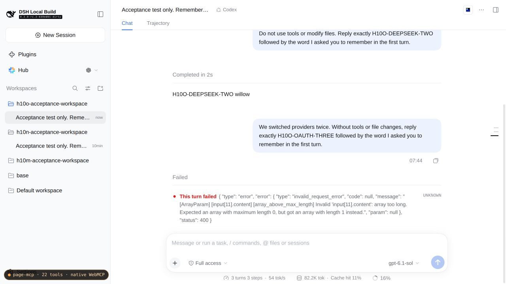

# Codex official / desktop-first 交付验收

2026-10-05，Asia/Hong_Kong。测试迭代终态 **0.1.10-o**；官方独立会话可用，跨 provider 回官方仍有下述已知限制。**用户随后明确确认阶段测试通过，要求停止 4999、清理现场并 push / publish 0.1.11**。该授权关闭当前阶段；自动 compact 未纳入本次交付，也不把下表的失败改记为通过。发布核验见 [0.1.11 收尾记录](2026-10-05-super-dsh-0.1.11-release.md)。未操作 prod 3080/3081。

## 已实现与构建验证

- binary 来源按 `CODEX_BIN` → installed desktop core → PATH CLI → exact-pin npm core；主路线包内 fallback 为 0.160.0。原生 executable 直接启动，JS launcher 经 Node。
- 原生 ChatGPT OAuth 发现为只读 `OpenAI OAuth` identity；token 留原生 home。显式选择通过 child config 覆盖 builtin `openai` 与 builtin endpoint；原生 config/auth 不由 adapter 写入。
- 子进程使用 Super D 自有 clientInfo，剥离继承的 desktop originator/tool-pipe env。桌面宿主工具能力另见 [能力调查](2026-10-05-codex-desktop-host-capabilities.md)。
- OAuth logout、原生 catalog 冲突、reserved ID 冲突与重复 alias 均失败关闭；原生 token 不进入 provider store。主路线与默认关闭的 SDK 线共享 provider/OAuth 单元保持一致。
- 0.1.10-m 经唯一 `scripts/pack.mjs` 与 `test/start-4999.sh` 打包并物理安装；4999 保持运行。代理仅由 rig 提供：DEV3 GOST，HTTP/HTTPS/ALL_PROXY，loopback NO_PROXY。
- 完整 11 包与 rig：**1662 pass / 0 fail / 0 skip**。构建测试是卫生检查，以下真实生成才是行为验收。

## 0.1.10-m 浏览器实测

当前版本新建 workspace：`.tests/superd/h10m-acceptance-workspace`。DSH session `session-0c2ed447-817c-4d57-a4be-1d43014c594e`；native thread `01a1092d-aa73-7920-a929-5b1403b0cfb0`。

| 操作 | 真实结果 |
| --- | --- |
| OpenAI OAuth / GPT-6.1-Sol 首轮 | PASS：07:09，assistant 返回 `H10M-OAUTH-ONE` |
| 切出 Codex world 再回来 | 首轮 transcript 已重放；后续完整 resume 链尚未完成 |
| 同 session 选择 DeepSeek / deepseek-flash | PASS：07:16，assistant 返回 `H10M-DEEPSEEK-TWO` |
| 同 session 再选 OpenAI OAuth / GPT-6.1-Sol | FAIL：remote auto compact 请求仍带 `deepseek-flash`，官方返回 400：该模型不支持 ChatGPT account |

失败发生时 UI model chip 为 GPT-6.1-Sol，app-server resume/turn 路由代码已传当前模型。正在核对 native pre-turn compaction 的模型来源；不能据前两轮通过宣称整条切换链通过。

## 0.1.10-n 浏览器实测

修正普通官方 launch 强制 static catalog 导致缓存不刷新的行为，并保留原生配置的官方默认模型 ID。独立复核无新增阻断问题；完整 **1666 pass / 0 fail / 0 skip**。唯一 launcher 实装 n，unit invocation `6ff50ffb2cc4477db154e36066a6e325`。

同版新 workspace `.tests/superd/h10n-acceptance-workspace`；DSH session `session-dff6b8ef-ce4a-4d55-b8e2-74a330fd5028`；native thread `01a10941-0c26-7620-be73-789234b2afa2`。

| 操作 | 真实结果 |
| --- | --- |
| 官方 SOL 首轮 | PASS：07:30，`H10N-OAUTH-ONE` |
| SOL → DeepSeek flash | FAIL：07:30，DeepSeek 收到 `gpt-6.1-sol` 压缩请求，拒绝 unsupported model |
| 重新选择官方 → Codex world 切到 DSH → 回 Codex | PASS：旧 turn/transcript 重放；07:33 返回 `H10N-RESUME maple`，保留首轮记忆 |
| 官方 shell 工具协议 | PASS：07:33，UI 展示 `command_execution`，IN `/bin/bash -c 'printf H10N-TOOL'`，OUT `H10N-TOOL`，assistant `H10N-TOOL-PASS` |

只读现场核对：自有 4999 child executable 为 `/usr/lib/chatgpt/resources/codex`；显式 `model_provider="openai"`，普通配置无 `model_catalog_json` override；HTTP/HTTPS proxy 为指定 DEV3 GOST，NO_PROXY 包含 loopback。原生 config.toml/auth.json 对初始指纹均未变化。

### 跨 provider compaction 根因

精确 0.160 源码会在 pre-turn 比较上一轮与当前模型的 `comp_hash`，需要兼容性处理时使用上一轮模型压缩。官方路径具有 current-model fallback，失败时仍回传原错误；第三方路径没有该 fallback。因此 m 的错误不能证明 adapter 没传当前模型，n 的反方向失败明确暴露上一轮模型发到了新 provider。

本 adapter 的第三方 catalog 从官方 template 复制完整元数据，误把仅属于官方模型的 `comp_hash` 也复制给了 DeepSeek。n 原生 rollout 观察到 SOL hash 3000、DeepSeek hash 2911；约 30K tokens 且 context window 从 258400 升至 950000，排除 context downshift，触发来源是虚假的 hash 差异。下一修正移除第三方合成条目中未经验证的官方 hash，保留正常 context-limit 压缩；不修改原生 rollout、不换 thread、不禁用压缩。

源码证据：[pre-turn compact](https://github.com/openai/codex/blob/rust-v0.160.0/codex-rs/core/src/session/turn.rs)、[current-model fallback](https://github.com/openai/codex/blob/rust-v0.160.0/codex-rs/core/src/compact_remote_v2.rs)。

## 0.1.10-o 浏览器实测

两条 Codex adapter 全部 **451 pass / 0 fail / 0 skip**，包含 4 条新的错误继承 hash 回归断言；不受此改动影响的其余组件沿用 n 完整回归结果。o 唯一 pack 为 357 文件，tarball `.scratch/superd-pack/super-dsh-0.1.10-o.tgz`；唯一 launcher 物理安装后读取 package.json 确认为 o。unit invocation `6361d3a043904052a6fd38dea6aeef4d`。

同版新 workspace `.tests/superd/h10o-acceptance-workspace`；DSH session `session-4e5cdec1-335d-4070-a115-2f1303ce41ce`；native thread `01a1094c-df4f-7e60-b3cb-b83a0b8879c4`。

| 操作 | 真实结果 |
| --- | --- |
| 官方 SOL 首轮 | PASS：07:43，`H10O-OAUTH-ONE` |
| SOL → DeepSeek flash | PASS：07:43，`H10O-DEEPSEEK-TWO willow`；首轮记忆保留 |
| DeepSeek flash → SOL | FAIL：07:44，官方 400：`input[11].content` 最大长度 0，实际长度 1 |

原生 rollout 中 DeepSeek turn 的 comp_hash 已为 None；新的 SOL turn_context 已写入，说明误触 hash compaction 已解决，当前失败位于普通 sampling。DeepSeek 新增 Reasoning item 的 content 含一个 reasoning_text、summary 为空，且带 encrypted_content；原始值未打印/复制入本报告。官方 Responses 对这种 reasoning 形态拒收，不能把不同 provider 的 Responses 历史视为完全可互换。

最后只读核对：当前 4999 child 仍为 `/usr/lib/chatgpt/resources/codex`，显式 `model_provider="openai"`；原生 config.toml/auth.json 对初始指纹均未变化。测试时实例保持运行；阶段收尾已按用户要求停止。

### 恢复接口与待讨论方案

精确 0.160 的实验性 resume.history 会走 Forked 初始历史，忽略传入 threadId，不能直接用于保持同一 native thread。手动 `thread/compact/start` 是正式异步操作：旧第三方 provider 可在自己的模型上生成摘要，并把上下文改为用户历史与 summary，从而移除不可移植 reasoning；它保留 thread 身份。

独立可行性探针已实际通过：native thread `01a10953-dc05-7f73-a785-e9e59ab8c893` 全程不变，official-first completed → DeepSeek-second completed（cedar）→ 旧 DeepSeek compact ACK `{}` 后等待 contextCompaction completed 与 turn/completed completed → official-third-after-compact completed（仍为 cedar）。探针使用独立 `/tmp` cwd、新 native thread、原位 OAuth、Super D identity、desktop 0.160 与同一 GOST；没有操作现有映射的 o thread。压缩后 replacement_history 为 3 个 message、reasoning_count 0、summary 1689 chars。**这是可行性证明，不是 4999 产品接入验收；没有修改产品代码接入该操作。**

这个候选方案会在第三方切回官方时增加一次旧 provider 请求，并让 native 工作上下文使用摘要；DSH 原 transcript 仍保留。属于会话语义的重要决定，需要按 user 要求讨论后执行。不能凭源码推断或 probe 成功代替 4999 交付验收。

后续实施还需要覆盖：等待 compact 真正完成而非只等 ACK；失败/取消时保留旧 provider 与原 thread；内部 compact 不伪装成用户生成回合；cold resume 根据可靠的 last-used provider/model 回到旧 route 完成 compact，无法定位或旧凭证缺失时明确失败。create/resume 查看仍保持零 native spawn，只有真实 prompt 进入此路径。

## 现场观察与验收边界

- 老版本遗留的 blank draft（threadId 为 null）会被上游 workspace 导航复用并进入 resume，随后报 `NATIVE_THREAD_NEVER_STARTED`。没有删除这些测试资产；本轮用同版本全新 workspace/session 验证公平路径。
- 共享 `models_cache.json` 在现场曾观察到 0.154 与 0.160 两种内容。0.160 自有 identity 的真实 `model/list` 可取得包括 SOL 的 8 个可见模型；较旧缓存不包含 SOL。缓存刷新进程的归属仍在核对，不把相关性作为因果结论。
- 不以 binary 路径推断 desktop browser/computer-use 已接通；本轮只验收独立 app-server adapter。SDK 世界未做真实模型生成验收。
- 跨 provider 历史方案确定后，下一迭代需在同版新 session 重跑 official → third-party → official → world handoff → replay/resume，并检查 native config/auth 指纹。旧 rollout 已写入的错误 hash 不追改；大上下文的 model-downshift compact 仍有独立触发条件，不在本轮简单新会话通过范围内。4999 是 user 本轮指定的第一验收线；未完成 DEV3 插件实装验收。
