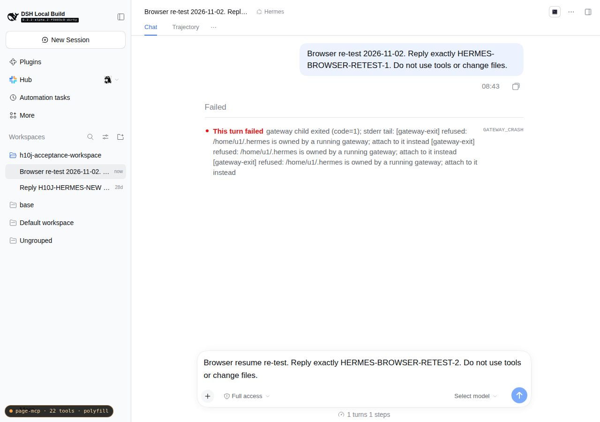
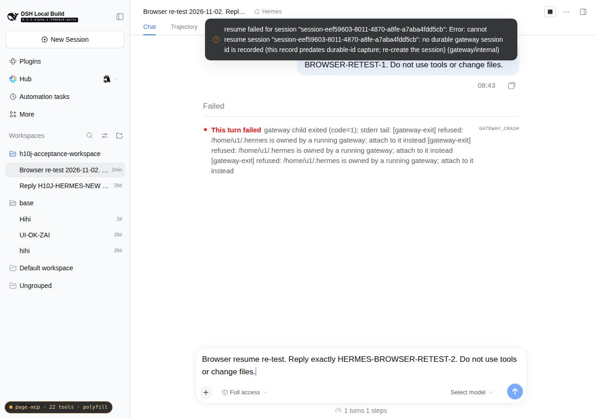
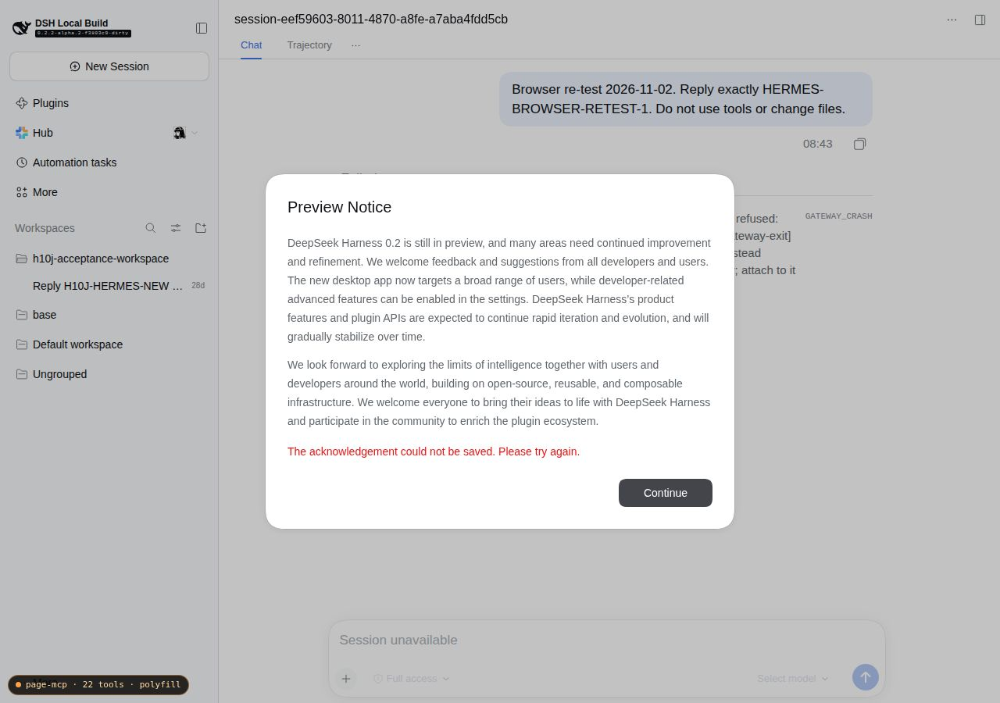

# 2026-11-02 — Hermes 修复后的浏览器用户流程复测

结论：**部分通过；Hermes 仍不能完成对话，不能视为行为验收通过。** 新建失败回合在刷新后可重新读取，抽查历史会话也能加载；首次 prompt 仍遇到 gateway 占用错误，再次发送遇到缺失 durable gateway session ID。Preview Notice 的确认失败已在真实页面复现。

关联：[原修复报告](2026-11-02-hermes-session-log-repair-and-ws-attach.md)。本报告只补充本轮浏览器证据，不替代原报告的 reader sweep，也不将未启用的 WS 桥记为通过。

## 环境与边界

- 时间：2026-11-02 08:42–08:45，Asia/Hong_Kong。
- 主机：`homepc`；入口：[4999 测试线](http://127.0.0.1:4999/)。使用用户提供的密码通过登录页正常 Unlock，未注入 cookie。
- 浏览器：用户指定的 CLI Browser，managed CDP Chromium，独立无头会话；doctor 显示 headless=true、visible=false。
- 页面宿主标识：`DSH Local Build 0.2.2-alpha.2-f3803c9-dirty`。
- 原生 Plugin Manager 实际显示 Super D `v0.3.3-f`，启用；来源为 `file:/home/u1/workspaces/superd/.scratch/superd-pack/super-dsh-0.3.3-f.tgz`。Better Dash 与测试 WebMCP 行均处于启用状态。
- 业务验证全部通过页面点击、输入和读取完成；没有调用应用 API、WebMCP 或脚本替代用户行为。
- 未构建、重新安装或重启服务，未修改 transport 或 gateway 配置，未访问生产端口或生产 home，未 publish / commit / tag / push。

## 复现步骤与结果

| 步骤 | 实际操作 | 页面结果 | 判断 |
|---|---|---|---|
| 1 | 打开 4999，填写密码，点击 Unlock | 进入 DSH；登录后初始新建页未自动显示 Preview Notice | 登录通过；不能据此断言弹窗已修复 |
| 2 | Hub → This machine → Switch to Hermes | 显示 Hermes 新建页，随后 Connected | 运行时选择通过 |
| 3 | 在既有 `h10j-acceptance-workspace` 中发送最小提示 | 创建新记录，最终显示 Failed / GATEWAY_CRASH；没有助手回复 | prompt 失败 |
| 4 | 从该会话点击 Trajectory | 观察到页面变为 Session unavailable，输入区禁用，且 Preview Notice 出现 | 会话在此次页面切换后暂不可用；仅据 UI 不判定内部原因 |
| 5 | 点击 Preview Notice 的 Continue；再按 Escape | 确认失败文字仍在，弹窗仍在 | 确认失败复现 |
| 6 | 完整刷新页面，再通过 Hub 切回本机 Hermes | 新会话重新出现在列表；失败回合、首条用户消息可读，输入恢复，显示 `1 turns 1 steps` | 新失败记录的浏览器重读通过 |
| 7 | 在同一会话发送第二条最小提示 | toast 报 resume failed，缺 durable gateway session ID；第二条仍留在输入框，没有新回合或回复 | resume / follow-up 失败 |
| 8 | 打开 base 下的 Hihi、UI-OK-ZAI、hihi | 三档均可读取；Hihi 的 Chat 展示历史成功回合及 gateway 失败，Trajectory 可读；UI-OK-ZAI 显示五次历史成功；hihi 显示历史模型/provider 不匹配错误 | 历史会话抽查可读 |
| 9 | 回到新建复测会话，再点一次 Send message 采集截图 | 再次出现同一 resume 错误，仍只有一个已记录回合 | resume 失败可重复 |

新建记录：`session-eef59603-8011-4870-a8fe-a7aba4fdd5cb`，列表名 `Browser re-test 2026-11-02. Reply exactl`。

首次输入：

```text
Browser re-test 2026-11-02. Reply exactly HERMES-BROWSER-RETEST-1. Do not use tools or change files.
```

再次输入：

```text
Browser resume re-test. Reply exactly HERMES-BROWSER-RETEST-2. Do not use tools or change files.
```

## 证据、发现与后续验证

### E1 → F1：stdio 占用错误仍阻止首条回复

Chat 的实际错误为 `GATEWAY_CRASH`，包含：

```text
gateway child exited (code=1)
[gateway-exit] refused: /home/u1/.hermes is owned by a running gateway; attach to it instead
```

这与原报告“默认仍 stdio、WS 回合映射未完成”的限制相符。连接状态和插件 Running 都不能代替 prompt 成功。后续需要完成并启用回合映射，再走相同用户流程验证新建、回复、继续与刷新恢复。



### E2 → F2：新建失败记录不能继续，恢复提示误判记录年代

再次发送时，页面 toast 为：

```text
resume failed for session "session-eef59603-8011-4870-a8fe-a7aba4fdd5cb": Error: cannot resume session "session-eef59603-8011-4870-a8fe-a7aba4fdd5cb": no durable gateway session id is recorded (this record predates durable-id capture; re-create the session) (gateway/internal)
```

记录是本轮刚创建的。缺 ID 可能与 gateway 在创建前失败有关，但内部因果未通过本轮 UI 测试确证；**将其直接称为 predates durable-id capture 与实际创建时间不符**。后续应验证冷启动失败后的继续/重试行为，并让恢复指引区分旧记录和本次启动失败。重建会话仍会遇到 E1，因此当前提示不能帮助用户恢复。



### E3 → F3：Preview Notice 确认失败真实复现

弹窗在切换至上述失败会话的过程中出现；点击 Continue 后继续显示：

```text
The acknowledgement could not be saved. Please try again.
```

Escape 也未关闭。完整刷新后回到默认 DSH 新建页时弹窗不在；再切回 Hermes 可阅读会话。本轮不能据此定位 settings 投影、wire 或其他内部原因，也不能称欢迎策略已通过。后续需覆盖发生问题的 Hermes 页面上下文，而不只检查默认 DSH 页。



## 覆盖限制与保留现场

本轮验证了 4999 已安装 tarball 的浏览器行为；未重新逐档执行真实 reader，因此不独立确认“174/174”或 15 个特定修复档的全部结构。历史抽查依据 UI 标题，未把它们强行映射为原报告的 session 前缀。其它 adapter 的 create/prompt/resume、dev3 实装、WS attach 的 ready/session.create 和尚未完成的回合映射，均未在本轮验收。

测试服务保持运行；复测会话保留，未归档/删除。第二条失败输入保留在该浏览器输入框中。没有源代码变更；本轮仅新增本报告和三张截图。
